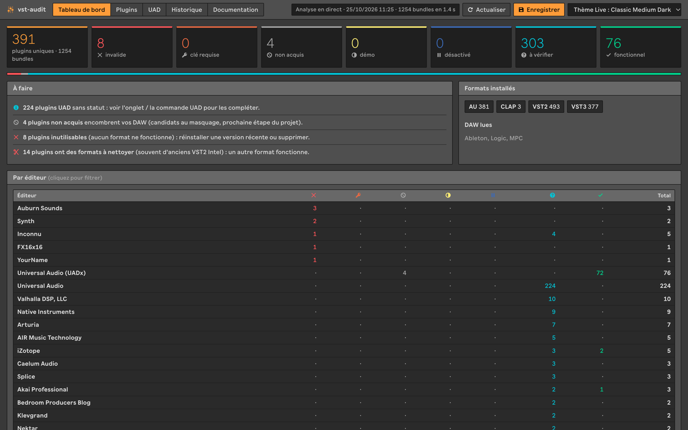
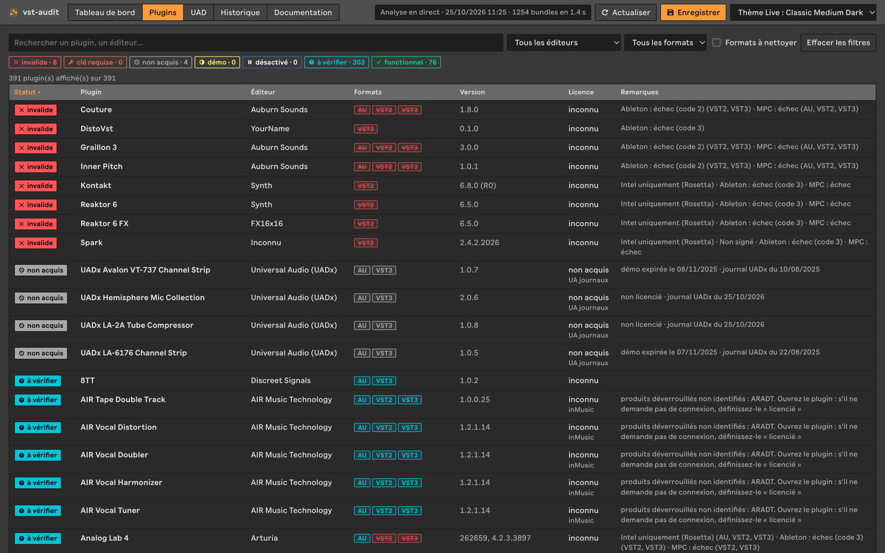
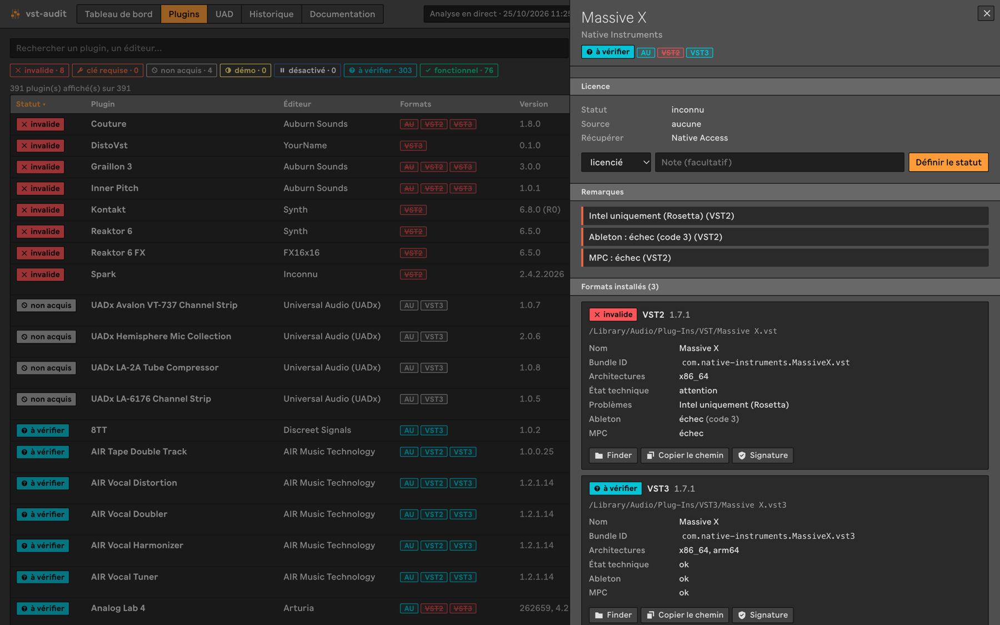
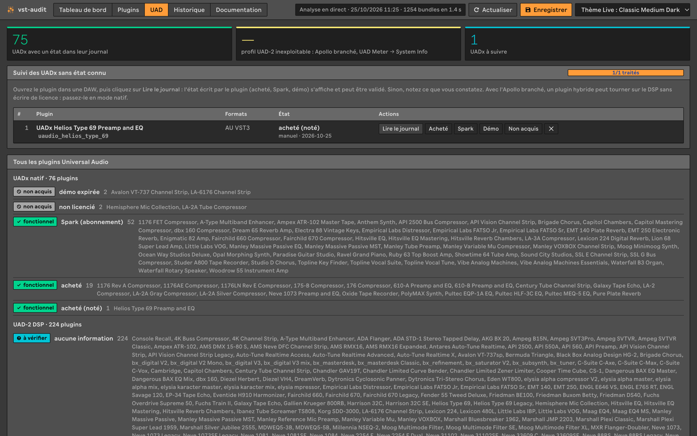
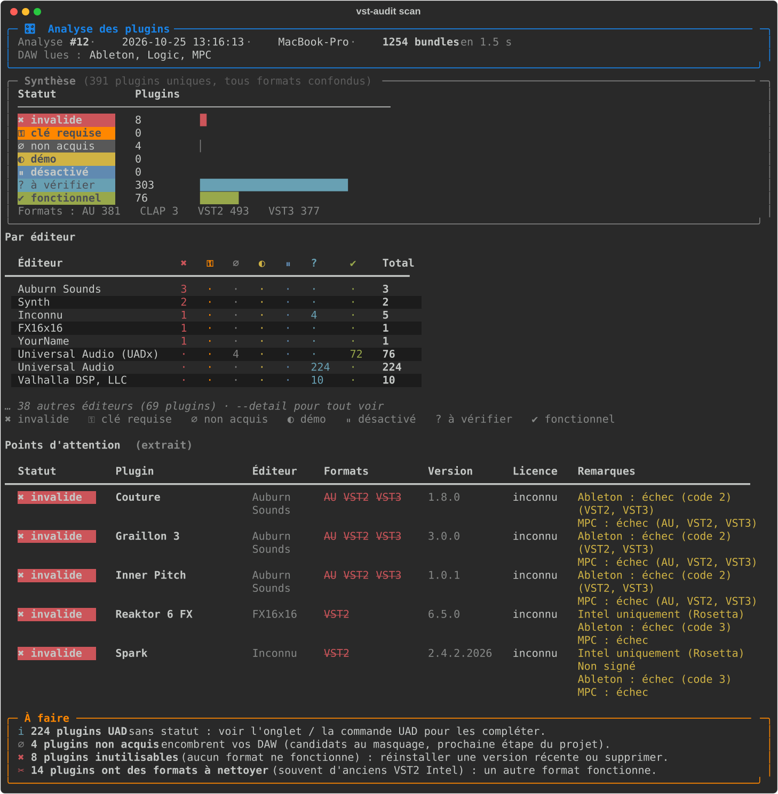

# vst-audit

Analyseur des plugins audio installés sur macOS (VST2, VST3, AU, CLAP). Pour chaque plugin, il dit :

- s'il est **techniquement valide** : bundle complet, binaire Apple Silicon ou Intel, signature, quarantaine ;
- s'il **fonctionne dans les DAW** : base de plugins d'Ableton Live, journaux de validation AU de Logic, liste de plugins de MPC 3 ;
- son **statut de licence** : licencié, gratuit, démo, non acquis, clé requise ou inconnu.

Chaque analyse est enregistrée, ce qui permet de **comparer** une analyse avec la précédente.

Aucun plugin n'est chargé ni modifié. L'outil lit seulement les fichiers sur le disque.

## Aperçu

L'interface web (`uv run vst-audit web`) reprend le thème et la police d'Ableton Live.

**Tableau de bord** : répartition des statuts, conseils « À faire », synthèse par éditeur.



**Plugins** : tableau filtrable et triable ; un même plugin n'occupe qu'une ligne, ses formats cassés sont barrés.



**Détail d'un plugin** : licence, remarques, chaque format avec son chemin, son architecture et son état dans Ableton, Logic et MPC 3, et les actions possibles (statut, Finder, signature, auval).



**UAD** : licences Universal Audio lues dans les journaux UA (achats, Spark, démos) et suivi des UADx un par un.



**Terminal** (`uv run vst-audit scan`) : la même analyse, dans la console.



## Installation

```bash
uv sync
```

## Utilisation

```bash
uv run vst-audit scan                    # analyse, enregistre, compare avec l'analyse précédente
uv run vst-audit scan --detail           # liste tous les plugins
uv run vst-audit scan -e "universal"     # filtre sur un éditeur
uv run vst-audit scan -s "clé requise"   # filtre sur un statut
uv run vst-audit scan --signatures       # vérifie aussi les signatures avec codesign (plus lent)
uv run vst-audit scan -v                 # plus de logs (-vv pour le débogage)

uv run vst-audit uad                     # licences UAD : achats, Spark, démos
uv run vst-audit uad --suivi             # ouvrir les UADx inconnus un par un et noter leur état
uv run vst-audit sonder                  # vérification active des plugins « à vérifier »
uv run vst-audit sonder -e arturia --statut tous   # … d'un éditeur, quel que soit leur statut
uv run vst-audit sonder -p "Mini V3" --refaire     # … d'un plugin précis
uv run vst-audit historique              # liste des analyses
uv run vst-audit voir 3                  # réaffiche l'analyse n° 3 sans rescanner
uv run vst-audit comparer                # avant-dernière analyse → dernière
uv run vst-audit comparer 1 5            # analyse 1 → analyse 5
```

## Interface web

```bash
uv run vst-audit web                     # ouvre http://127.0.0.1:8765 dans le navigateur
uv run vst-audit web --port 9000 --pas-ouvrir
```

| Onglet | Contenu |
|---|---|
| Tableau de bord | Répartition des statuts, conseils « À faire », synthèse par éditeur (tout est cliquable pour filtrer) |
| Plugins | Tableau filtrable (recherche, statut, éditeur, format, formats à nettoyer) et triable. Un clic sur une ligne ouvre le détail : licence, remarques, chaque format avec son chemin, son architecture, son état dans Ableton et Logic |
| UAD | Sources de licence UA, suivi des UADx un par un (lire le journal, noter l'état), vue d'ensemble par famille |
| Historique | Analyses enregistrées : ouvrir une analyse passée, comparer deux analyses |
| Documentation | Mode d'emploi, statuts, sources, liste des routes de l'API |

Actions disponibles depuis le détail d'un plugin :

- définir son statut de licence (enregistré dans `data/overrides.json`, prioritaire sur la détection) ;
- le montrer dans le Finder ou copier son chemin ;
- vérifier sa signature (`codesign`) ;
- valider une Audio Unit (`auval`) ;
- le sonder (vérification active, voir plus bas) ;
- relire le journal de licence d'un UADx.

L'apparence reprend celle d'Ableton Live : les couleurs du thème choisi dans Live (lu dans `Preferences.cfg` et dans les fichiers `.ask` de l'application) et la police Ableton Sans, servie depuis l'application Live installée (rien n'est copié dans le projet). Un sélecteur permet d'essayer les autres thèmes de Live ; sans Live, les couleurs de « Default Dark Neutral Medium » s'appliquent.

« Actualiser » relance l'analyse en direct, sans l'enregistrer. « Enregistrer » l'ajoute à l'historique et affiche les changements depuis l'analyse précédente. Les liens sont directs : `#plugins`, `#uad`, `#plugins&plugin=<clé>`.

### API

L'interface communique avec l'outil par une API JSON (FastAPI). Elle n'écoute que sur 127.0.0.1, car certaines actions lancent des commandes locales. Les actions sur un bundle n'acceptent que les chemins trouvés par l'analyse. La documentation interactive est disponible sur `/api/docs`.

| Route | Rôle |
|---|---|
| `GET /api/analysis` | analyse en direct (`?refresh=true` pour la relancer) |
| `POST /api/scans` · `GET /api/scans` · `GET /api/scans/{id}` | enregistrer une analyse, lister l'historique, relire une analyse |
| `GET /api/diff?old=&new=` | comparer deux analyses |
| `GET /api/plugin?key=` | détail d'un plugin, tous formats confondus |
| `PUT` / `DELETE /api/plugin/override` | définir un statut ou revenir à la détection automatique |
| `POST /api/plugin/{reveal,signature,auval}` | actions sur un bundle |
| `GET /api/uad` · `POST /api/uad/check/{id}` · `PUT /api/uad/suivi/{id}` | sources UA, lecture d'un journal, suivi |

## Statuts affichés

Un même plugin peut être installé en plusieurs formats (AU, VST3, VST2). Ils sont regroupés sur une seule ligne. Le statut retenu est celui du **meilleur format**. Les formats cassés apparaissent barrés en rouge (par exemple un vieux VST2 Intel à côté d'un VST3 qui fonctionne).

| Statut | Signification |
|---|---|
| ✖ invalide | Aucun format ne fonctionne : binaire manquant, plugin rejeté par Ableton, échec de validation dans Logic… |
| ⚿ clé requise | Plugin à réactiver : clé perdue, changement d'ordinateur |
| ∅ non acquis | Plugin installé mais jamais acheté (cas typique : le catalogue UAD) |
| ◐ démo | Version d'essai |
| ⏸ désactivé | Plugin désactivé dans une DAW |
| ? à vérifier | Plugin techniquement OK, mais sa licence n'a pas pu être déterminée |
| ✔ fonctionnel | Plugin OK et licence confirmée (ou plugin gratuit) |

## Vérification active (`vst-audit sonder`)

Quand les fichiers ne disent rien, on observe le plugin en fonctionnement. Chaque plugin est chargé dans un processus séparé (un plantage n'emporte que la sonde) :

1. **Licence** : la boucle d'événements macOS tourne quelques secondes, le temps que les vérifications asynchrones aboutissent. Effet utile : les UADx écrivent alors leur état PACE à jour dans leur journal UA.
2. **Son** : un signal test (1 s de son, 1 s de silence) ou des notes MIDI pour un instrument. Le plugin peut traiter le son, rester muet (bloqué sur un écran d'activation) ou le laisser passer intact (c'est ce que fait un UADx non licencié).
3. **Interface** (option, activée par défaut) : la fenêtre du plugin s'ouvre une dizaine de secondes, est capturée, puis son texte est lu par l'OCR de macOS (Vision). Les écrans « This software is not activated on this computer · 4 activations left » (Arturia) ou « Activate your product · TRY UNLICENSED » (AIR) donnent l'état exact. Les e-mails sont masqués dans les résultats.

| Ce que la sonde observe | Statut |
|---|---|
| « not activated », « activations left » | clé requise (licence possédée, à réactiver sur ce Mac) |
| « activate your product », « try unlicensed », « serial key » | clé requise (non activé) |
| « trial », « demo » | démo |
| « expired » | non acquis |
| assistant d'activation PACE / iLok lancé au chargement | clé requise (protection iLok) |
| fenêtre ouverte au chargement avec un des textes ci-dessus | même statut |
| son passé intact (UADx natifs) | non acquis |
| interface lisible sans écran de licence (même muet ou neutre par défaut) | fonctionnel |
| plantage, blocage, interface illisible | non concluant |

Garde-fous :

- **Repli de format** : si l'AU plante ou bloque (fréquent avec un sidechain ou plusieurs bus), le VST3 est essayé. Pendant une session, un éditeur pour qui le repli a marché commence directement par le VST3.
- **Délais par étape** : rendu audio 30 s, interface 45 s. Si l'interface bloque, le résultat audio déjà mesuré est conservé.
- **Vigie au chargement** (après 20 s) : si l'assistant PACE tourne ou si une fenêtre est ouverte, on la lit et on arrête la sonde. Sans fenêtre, le plugin est seulement lent (Kontakt : ~30 s) et on attend.
- **Plugins écartés d'avance** : les plugins-hôtes (MPC, Nektarine…), qui plantent l'hôte de test, et les UAD-2 quand aucun Apollo n'est branché (ils affichent une alerte bloquante).
- **Disjoncteur** : après 3 échecs de suite chez un même éditeur, ses plugins suivants sont sautés pour la session.

Seuls les AU et VST3 natifs Apple Silicon peuvent être chargés : un plugin Intel uniquement n'est pas sondable. Comptez environ 25 s par plugin avec l'interface, 10 s sans (`--sans-interface`). Résultats : `data/sondes.json` et les captures dans `data/sondes/`. Dans l'interface web, le bouton **Sonder ce plugin** se trouve dans le panneau de détail.

## Déclarer ses licences : `config/licences.toml`

La plupart des éditeurs chiffrent leurs licences ou les gardent en ligne. L'outil ne peut donc pas tout deviner. Pour compléter :

```bash
cp config/licences.example.toml config/licences.toml
```

**UAD** : UA Connect installe tout le catalogue. Les licences sont lues automatiquement dans les fichiers locaux d'UA (commande `uv run vst-audit uad` pour le détail) :

1. **UADx (achats et Spark)** : à chaque ouverture en natif, un plugin UADx écrit son état de licence PACE dans `~/Library/Logs/Universal Audio/UAPW_*.txt`. L'outil reconnaît les états acheté, Spark (abonnement), démo (avec sa date de fin), démo expirée et non licencié. Un UADx jamais ouvert en natif reste « à vérifier » : il suffit de l'ouvrir une fois dans une DAW.
2. **UAD-2 (DSP)** : les autorisations sont lues dans `UADSystemProfile_cur.txt`, à condition que ce profil ait été généré avec l'Apollo branché (« UAD Meter & Control Panel » → System Info).
3. **Suivi interactif** (`vst-audit uad --suivi`) : liste les UADx sans état connu, un par un. Vous ouvrez le plugin dans une DAW, Entrée relit son journal ; à défaut, vous notez ce que vous voyez (acheté, Spark, démo, non acquis). La progression est enregistrée dans `data/uad_suivi.json` : vous pouvez quitter et reprendre, et les notes sont prises en compte par `scan`.
4. **En dernier recours** : listez vos achats dans `[uad].possedes`, puis passez `strict = true` pour classer « non acquis » tout plugin UAD sans licence trouvée.

## Fichiers produits

Tout est stocké dans `data/`, qui n'est pas versionné :

- `data/history.sqlite` : historique complet de toutes les analyses ;
- `data/scans/AAAA-MM-JJ_HHMMSS_scanN.json` : instantané lisible de chaque analyse ;
- `data/logs/AAAA-MM-JJ_HHMMSS.log` : journal détaillé (niveau DEBUG) de chaque analyse.

## Sources lues

| Source | Emplacement |
|---|---|
| Plugins | `/Library/Audio/Plug-Ins/{VST,VST3,Components,CLAP}` et `~/Library/Audio/Plug-Ins/…` (y compris les sous-dossiers) |
| Ableton Live | `~/Library/Application Support/Ableton/Live Database/Live-plugins-*.db` (lecture seule) |
| Logic | `~/Library/Caches/AudioUnitCache/Logs/AUScan*.plist` |
| MPC 3 | `~/Library/Application Support/Akai/MPC 3/MPC 3.settings` : plugins scannés, rejetés au scan, désactivés |
| iZotope | `~/Library/Preferences/com.izotope.*.Authorizations.plist` |
| Universal Audio | `~/Library/Logs/Universal Audio/UAPW_*.txt` (UADx), `UADSystemProfile_cur.txt` (UAD-2) |
| AIR / inMusic | `~/Library/Application Support/com.inmusicbrands.softwareunlock/` : un fichier par produit déverrouillé (ex. `AKMP3` = MPC 3) |

Codes d'Ableton (`scanstate`) : 1 signifie que le scan a réussi. Les codes 2 et 3 désignent un plugin rejeté par Live. Leur sens exact n'est pas documenté : le code 3 correspond souvent à un binaire Intel, le code 2 à un plugin qui a planté pendant le scan.

## Architecture

```
src/vst_audit/
  discovery.py     recherche des bundles, Info.plist, architecture Mach-O, signature, quarantaine
  hosts/           état des plugins vu par chaque DAW (ableton.py, logic.py, mpc.py)
  licenses/        détecteurs de licence, essayés dans l'ordre : manual → uad → sonde → izotope → inmusic → free (le premier résultat concluant l'emporte)
  grouping.py      regroupement des formats d'un même plugin
  store.py         historique SQLite et instantanés JSON
  diff.py          comparaison de deux analyses
  report.py        affichage console (rich)
  pipeline.py      chaîne d'analyse commune à la CLI et à l'API
  insights.py      conseils « À faire » (console et web)
  api.py           API FastAPI + service de l'interface
  web/             interface (HTML, CSS, JS sans dépendance externe ni build)
  overrides.py     statuts définis depuis l'interface
  suivi.py         suivi UADx (terminal et web)
  actions.py       Finder, codesign, auval, journal UA
  sonde/           vérification active : worker.py (processus de sonde) et classement des résultats
  theme.py         thème Ableton Live (couleurs .ask, police Ableton Sans) pour l'interface
  vendors.py       outil ou compte où récupérer ses licences, par éditeur
```

**Ajouter un éditeur** : créez `licenses/<editeur>.py` avec une fonction `detect(plugin, cfg) -> LicenseResult | None`, puis ajoutez-le à `DETECTORS`.

**Ajouter une DAW** : créez `hosts/<daw>.py` avec `NAME` et une fonction `annotate(plugins) -> bool`, puis ajoutez-le à `HOSTS`.

## Pistes pour la suite

- **Masquer les plugins non acquis** (UAD) dans Logic, Ableton et MPC : les déplacer vers un dossier de quarantaine, avec possibilité de restaurer.
- **`auval`** : valider les AU à la demande (`auval -v type sous-type fabricant`).
- **Sonde** : reconnaître d'autres écrans d'activation (iLok, Native Access…) au fil des plugins sondés.
- **iLok / PACE** : repérer les plugins protégés par iLok, dont la licence est liée au compte et donc récupérable.
- Détecteurs pour d'autres éditeurs : Native Instruments, Arturia, Softube, Slate…
